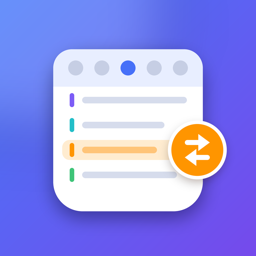
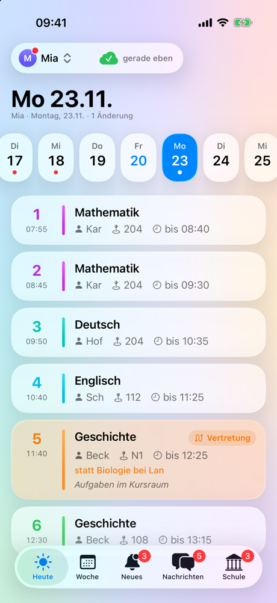
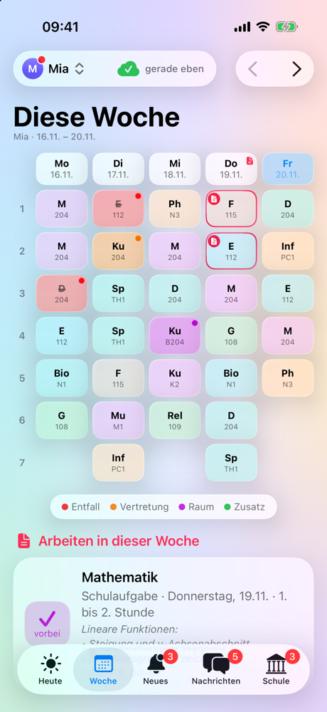
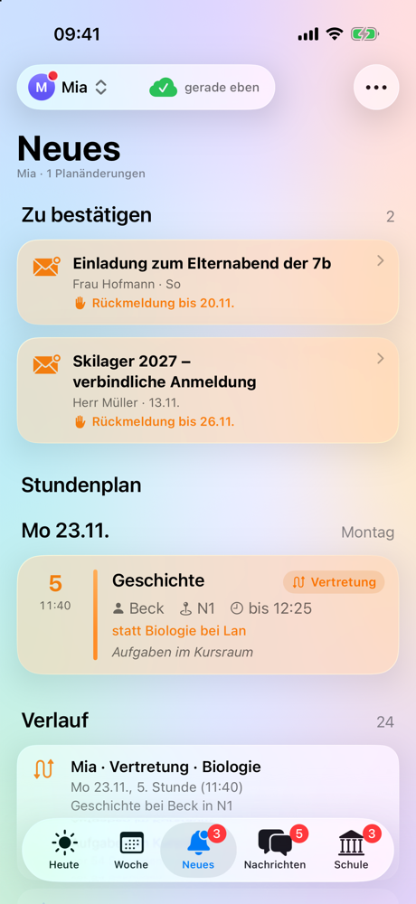
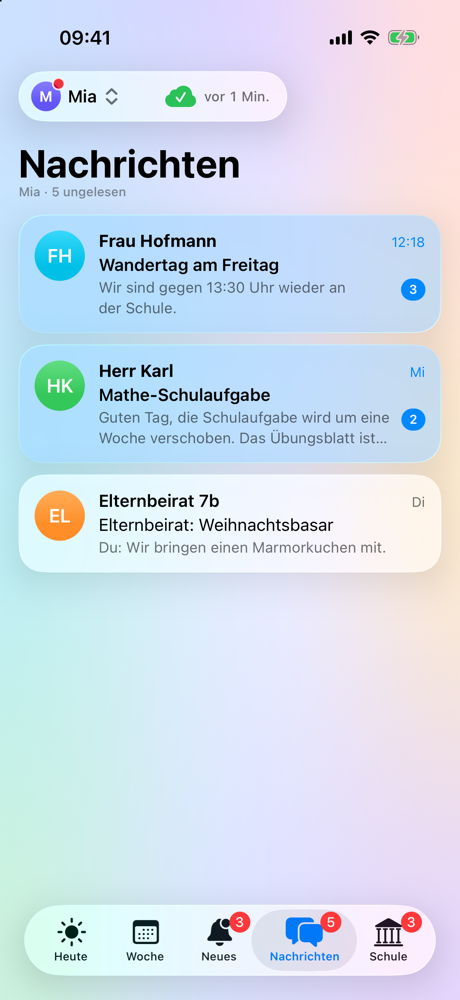
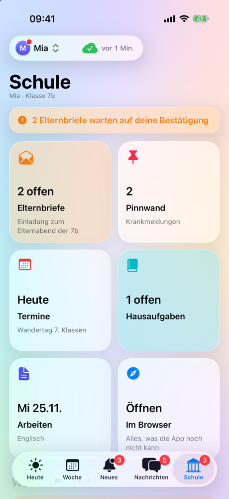

<p align="center">
  
</p>

<h1 align="center">Schulplan</h1>

<p align="center">
  Eine native iOS-App für Eltern, die mit <b>Schulmanager Online</b> arbeiten:<br>
  Stundenplan, Vertretungen, Elternbriefe und Nachrichten – übersichtlich, mit Widgets und Mitteilungen.
</p>

<p align="center">
  
  
  
  
</p>

> [!IMPORTANT]
> Schulplan ist ein **inoffizielles Privatprojekt**. Es steht in keiner Verbindung zur Schulmanager Online GmbH
> und wird von ihr weder unterstützt noch geprüft. Mehr dazu unter [Rechtliches](#rechtliches).

## Screenshots

<p align="center">
  
  
  
  
  
</p>

<sub>Alle Screenshots zeigen den eingebauten Demo-Modus mit frei erfundenen Daten.</sub>

## Funktionen

| Bereich | Was die App zeigt |
| --- | --- |
| **Heute** | Den Tagesplan mit Uhrzeiten, Lehrkraft und Raum. Ausfälle, Vertretungen und Raumänderungen sind farbig markiert. |
| **Woche** | Den Stundenplan als Wochenraster mit Legende sowie die anstehenden Arbeiten der Woche. |
| **Neues** | Elternbriefe, die noch bestätigt werden müssen, kommende Planänderungen und den Verlauf aller erkannten Änderungen. |
| **Nachrichten** | Die Unterhaltungen aus dem Messenger, mit Zähler für ungelesene Nachrichten. |
| **Schule** | Elternbriefe, Pinnwand, Termine, Hausaufgaben, Arbeiten, Noten und einen direkten Sprung in die Web-App. |

Außerdem:

- **Widgets** für den Home-Bildschirm: „Stundenplan“ (laufende und nächste Stunde) und „Planänderungen“.
- **Mitteilungen** im Hintergrund, sobald sich am Plan etwas ändert oder eine neue Nachricht eintrifft.
- **Mehrere Kinder** in einem Konto, mit schnellem Wechsel oben links.
- **Demo-Modus** zum Ausprobieren ohne Konto.
- Zugangsdaten liegen ausschließlich im iOS-Schlüsselbund auf dem Gerät. Es gibt keinen eigenen Server, die App spricht nur direkt mit Schulmanager Online.

## Bauen

Voraussetzungen: Xcode 26 und [XcodeGen](https://github.com/yonaskolb/XcodeGen).

```sh
brew install xcodegen
xcodegen generate
open Schulplan.xcodeproj
```

Für ein echtes Gerät in `project.yml` das eigene `DEVELOPMENT_TEAM` und bei Bedarf eigene Bundle-IDs eintragen.

### Screenshots im Simulator

In Debug-Builds gibt es zwei Startargumente:

```sh
xcrun simctl launch booted de.codeunity.Schulplan -autoDemo YES      # direkt im Demo-Modus starten
xcrun simctl launch booted de.codeunity.Schulplan -startTab week     # week | changes | messages | school
```

Das App-Icon entsteht per Skript: `python3 Tools/make_app_icon.py <Zielordner>` (benötigt Pillow).

## Aufbau

```
Schulplan/
├── API/        Zugriff auf Schulmanager Online und Parser für die Antworten
├── App/        App-Einstieg und zentrales AppModel
├── Model/      Datenmodelle
├── Shared/     Code, den App und Widget gemeinsam nutzen
├── Storage/    Schlüsselbund und lokaler Speicher
├── Sync/       Abgleich, Änderungserkennung, Mitteilungen, Demo-Daten
└── Views/      SwiftUI-Oberfläche
SchulplanWidget/  WidgetKit-Erweiterung
Tools/            Hilfsskripte (App-Icon)
```

## Rechtliches

- „Schulmanager Online“ ist eine Marke ihrer jeweiligen Inhaber. Der Name wird hier nur verwendet, um zu beschreiben,
  mit welchem Dienst die App zusammenarbeitet. Es besteht keine Partnerschaft, Lizenz oder Billigung.
- Das Repository enthält **keinen Code, keine Logos, Grafiken oder Texte** von Schulmanager Online.
  App-Icon und alle Grafiken sind selbst erstellt, die Symbole stammen aus Apples SF Symbols.
- Alle Namen, Klassen und Inhalte in den Demo-Daten und Screenshots sind frei erfunden.
- Die App nutzt nur das eigene Konto der Eltern und greift auf dieselben Daten zu wie die offizielle Web-App.
  Wer sie verwendet, ist selbst dafür verantwortlich, die Nutzungsbedingungen von Schulmanager Online einzuhalten.
- Die Schnittstelle ist nicht öffentlich dokumentiert und kann sich jederzeit ändern.

## Lizenz

[MIT](LICENSE) © 2026 Michael Silzle
